

<a href="https://github.com/Cec1c"><picture><source media="(prefers-color-scheme: dark)" srcset="./assets/hero-terminal-dark.svg"><source media="(prefers-color-scheme: light)" srcset="./assets/hero-terminal-light.svg"></picture></a>&#8194;<a href="https://mansus.cc"><picture><source media="(prefers-color-scheme: dark)" srcset="./assets/hero-identity-dark.svg"><source media="(prefers-color-scheme: light)" srcset="./assets/hero-identity-light.svg">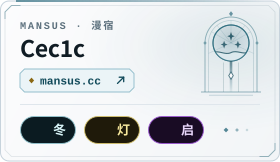</picture></a>

<!-- PROFILE-EN:FEATURED:START -->

<a href="https://github.com/Cec1c?tab=repositories"><picture><source media="(prefers-color-scheme: dark)" srcset="./assets/section-works-en-dark.svg"><source media="(prefers-color-scheme: light)" srcset="./assets/section-works-en-light.svg"></picture></a> <a href="https://github.com/Cec1c/Aletheia-Lens"><picture><source media="(prefers-color-scheme: dark)" srcset="./assets/work-aletheia-lens-en-dark.svg"><source media="(prefers-color-scheme: light)" srcset="./assets/work-aletheia-lens-en-light.svg">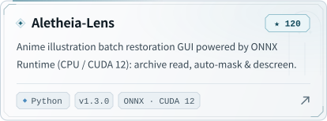</picture></a>&#8194;<a href="https://github.com/Cec1c/ServerS5A3"><picture><source media="(prefers-color-scheme: dark)" srcset="./assets/work-servers5a3-en-dark.svg"><source media="(prefers-color-scheme: light)" srcset="./assets/work-servers5a3-en-light.svg">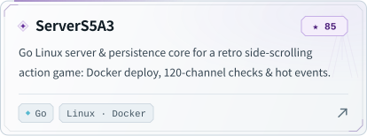</picture></a> <a href="https://github.com/Cec1c/PurpleMagic"><picture><source media="(prefers-color-scheme: dark)" srcset="./assets/work-purplemagic-en-dark.svg"><source media="(prefers-color-scheme: light)" srcset="./assets/work-purplemagic-en-light.svg">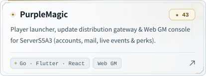</picture></a>&#8194;<a href="https://github.com/Cec1c/MortarHUD"><picture><source media="(prefers-color-scheme: dark)" srcset="./assets/work-mortarhud-en-dark.svg"><source media="(prefers-color-scheme: light)" srcset="./assets/work-mortarhud-en-light.svg">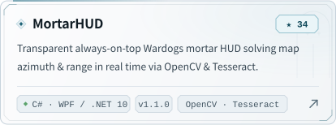</picture></a> <a href="https://github.com/Cec1c/PVF-MCP"><picture><source media="(prefers-color-scheme: dark)" srcset="./assets/work-pvf-mcp-en-dark.svg"><source media="(prefers-color-scheme: light)" srcset="./assets/work-pvf-mcp-en-light.svg">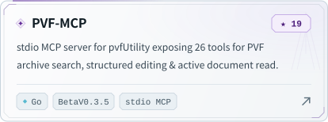</picture></a>&#8194;<a href="https://github.com/Cec1c/codex-cli-ultra"><picture><source media="(prefers-color-scheme: dark)" srcset="./assets/work-codex-cli-ultra-en-dark.svg"><source media="(prefers-color-scheme: light)" srcset="./assets/work-codex-cli-ultra-en-light.svg">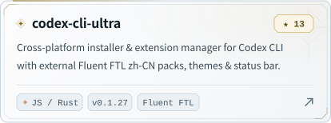</picture></a>

<!-- PROFILE-EN:FEATURED:END -->

<!-- PROFILE-EN:CONTRIB:START -->

<a href="https://github.com/Cec1c"><picture><source media="(prefers-color-scheme: dark)" srcset="./assets/section-upstream-en-dark.svg"><source media="(prefers-color-scheme: light)" srcset="./assets/section-upstream-en-light.svg"></picture></a> <a href="https://github.com/Kuddev/pebrel/pull/307"><picture><source media="(prefers-color-scheme: dark)" srcset="./assets/upstream-pebrel-en-dark.svg"><source media="(prefers-color-scheme: light)" srcset="./assets/upstream-pebrel-en-light.svg">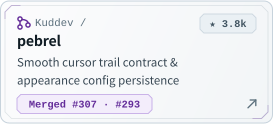</picture></a>&#8194;<a href="https://github.com/seakee/CPA-Manager-Plus/pull/463"><picture><source media="(prefers-color-scheme: dark)" srcset="./assets/upstream-cpamp-en-dark.svg"><source media="(prefers-color-scheme: light)" srcset="./assets/upstream-cpamp-en-light.svg">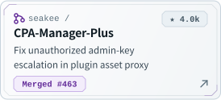</picture></a>&#8194;<a href="https://github.com/taekchef/claude-code-zh-cn/pull/11"><picture><source media="(prefers-color-scheme: dark)" srcset="./assets/upstream-cc-zh-en-dark.svg"><source media="(prefers-color-scheme: light)" srcset="./assets/upstream-cc-zh-en-light.svg">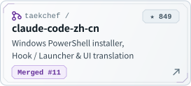</picture></a> Merged PRs &nbsp;·&nbsp; Kuddev/pebrel <a href="https://github.com/Kuddev/pebrel/pull/307">#307</a> · <a href="https://github.com/Kuddev/pebrel/pull/293">#293</a> &nbsp;｜&nbsp; seakee/CPA-Manager-Plus <a href="https://github.com/seakee/CPA-Manager-Plus/pull/463">#463</a> &nbsp;｜&nbsp; taekchef/claude-code-zh-cn <a href="https://github.com/taekchef/claude-code-zh-cn/pull/11">#11</a>

<!-- PROFILE-EN:CONTRIB:END -->

<picture><source media="(prefers-color-scheme: dark)" srcset="./assets/divider-winter-dark.svg"><source media="(prefers-color-scheme: light)" srcset="./assets/divider-winter-light.svg"></picture> <picture><source media="(prefers-color-scheme: dark)" srcset="https://raw.githubusercontent.com/Cec1c/Cec1c/output/github-contribution-grid-snake-dark.svg"><source media="(prefers-color-scheme: light)" srcset="https://raw.githubusercontent.com/Cec1c/Cec1c/output/github-contribution-grid-snake.svg"></picture>

<a href="https://mansus.cc"><picture><source media="(prefers-color-scheme: dark)" srcset="./assets/dock-blog-en-dark.svg"><source media="(prefers-color-scheme: light)" srcset="./assets/dock-blog-en-light.svg"></picture></a>&#8194;<a href="https://ifdian.net/a/Cecic"><picture><source media="(prefers-color-scheme: dark)" srcset="./assets/dock-ifdian-en-dark.svg"><source media="(prefers-color-scheme: light)" srcset="./assets/dock-ifdian-en-light.svg">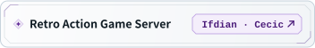</picture></a>&#8194;<a href="https://qm.qq.com/cgi-bin/qm/qr?group_code=908172336"><picture><source media="(prefers-color-scheme: dark)" srcset="./assets/dock-qq-en-dark.svg"><source media="(prefers-color-scheme: light)" srcset="./assets/dock-qq-en-light.svg"></picture></a> <a href="./README.md">简体中文</a> &nbsp;｜&nbsp; <strong>English</strong>

