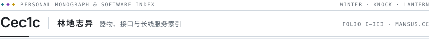

<picture>
  <source media="(prefers-color-scheme: dark)" srcset="./assets/masthead-dark.svg">
  
</picture>

  Personal Blog <a href="https://mansus.cc"><strong>mansus.cc</strong></a> &nbsp;·&nbsp; <a href="./README.md">简体中文</a> / <strong>English</strong> &nbsp;·&nbsp; Three Folios: Winter · Knock · Lantern

An index of standalone local tools, terminal extensions, upstream patches, and long-running server infrastructure, arranged in three thematic chapters. Most desktop programs here were built to solve a single concrete problem cleanly and remain quietly finished within their intended scope; the server stack and community infrastructure continue to be maintained through day-to-day operation.

<h3>
  <picture>
    <source media="(prefers-color-scheme: dark)" srcset="./assets/chapter-winter-dark.svg">
    
  </picture> 
  &nbsp; Quiet Instruments
</h3>

Self-contained local vision and screen-reading utilities built for offline desktop workflows, kept as finished instruments without cloud dependencies.

  <strong><a href="https://github.com/Cec1c/Aletheia-Lens">Aletheia-Lens</a></strong> &nbsp;<code>★ 120</code> &nbsp;<samp>Python · ONNX Runtime (CPU / CUDA 12)</samp> 
  Local Windows batch restoration GUI for anime illustrations and manga, featuring direct archive reading, automatic mask detection, and descreen processing.

  <strong><a href="https://github.com/Cec1c/MortarHUD">MortarHUD</a></strong> &nbsp;<code>★ 34</code> &nbsp;<samp>C# / WPF · .NET 10</samp> 
  Transparent always-on-top mortar ballistic HUD for <em>Wardogs</em>, reading absolute map coordinates via OpenCV and Tesseract to compute azimuth and range in real time.

<h3>
  <picture>
    <source media="(prefers-color-scheme: dark)" srcset="./assets/chapter-knock-dark.svg">
    
  </picture> 
  &nbsp; Thresholds &amp; Interfaces
</h3>

Protocol bridges and CLI extension managers connecting archive formats and terminal workflows, alongside targeted patches contributed upstream.

  <strong><a href="https://github.com/Cec1c/PVF-MCP">PVF-MCP</a></strong> &nbsp;<code>★ 19</code> &nbsp;<samp>Go · stdio MCP</samp> 
  MCP server for pvfUtility exposing 26 tools for PVF archive search, structured editing, serialized saving, and active document inspection.

  <strong><a href="https://github.com/Cec1c/codex-cli-ultra">codex-cli-ultra</a></strong> &nbsp;<code>★ 13</code> &nbsp;<samp>JS / Rust</samp> 
  Cross-platform installer and extension manager for Codex CLI, supporting external Fluent FTL Chinese language packs, terminal themes, and status bar extensions.

###### UPSTREAM PATCHES

- **[Kuddev/pebrel](https://github.com/Kuddev/pebrel)** &nbsp;`★ 3.7k` &nbsp;—&nbsp; Smooth cursor trail contract and appearance configuration persistence ([#307](https://github.com/Kuddev/pebrel/pull/307) · [#293](https://github.com/Kuddev/pebrel/pull/293))
- **[seakee/CPA-Manager-Plus](https://github.com/seakee/CPA-Manager-Plus)** &nbsp;`★ 4.0k` &nbsp;—&nbsp; Fixed unauthorized admin key privilege escalation in the plugin asset proxy ([#463](https://github.com/seakee/CPA-Manager-Plus/pull/463))
- **[taekchef/claude-code-zh-cn](https://github.com/taekchef/claude-code-zh-cn)** &nbsp;`★ 848` &nbsp;—&nbsp; Windows PowerShell installer, Hook / Launcher integration, and UI localization ([#11](https://github.com/taekchef/claude-code-zh-cn/pull/11))

<h3>
  <picture>
    <source media="(prefers-color-scheme: dark)" srcset="./assets/chapter-lantern-dark.svg">
    
  </picture> 
  &nbsp; Long-Burning Stack
</h3>

Open-source Linux game server core and distribution gateway stack for a retro side-scrolling action game, together with the non-profit community server run atop it.

  <strong><a href="https://github.com/Cec1c/ServerS5A3">ServerS5A3</a></strong> &nbsp;<code>★ 84</code> &nbsp;<samp>Go · Linux / Docker</samp> 
  Go Linux server and save-data core for a retro side-scrolling action game, supporting containerized deployment, 120-channel table validation, and event toggle configuration.

  <strong><a href="https://github.com/Cec1c/PurpleMagic">PurpleMagic</a></strong> &nbsp;<code>★ 43</code> &nbsp;<samp>Go / Flutter / React</samp> 
  Companion player launcher, update distribution gateway, and Web GM console for ServerS5A3 covering accounts, item mail, events, and persistent benefits.

> **Community Server Note** &nbsp;·&nbsp; A non-profit community server runs continuously on the open-source stack above. Operational notes and support channels are hosted on Afdian (**[Cecic](https://ifdian.net/a/Cecic)**), and players coordinate via **QQ Group [908172336](https://qm.qq.com/cgi-bin/qm/qr?group_code=908172336)**.

  <picture>
    <source media="(prefers-color-scheme: dark)" srcset="./assets/colophon-dark.svg">
    
  </picture> 
  

  Personal Blog <a href="https://mansus.cc">mansus.cc</a> &nbsp;·&nbsp; <a href="./README.md">简体中文版</a>

